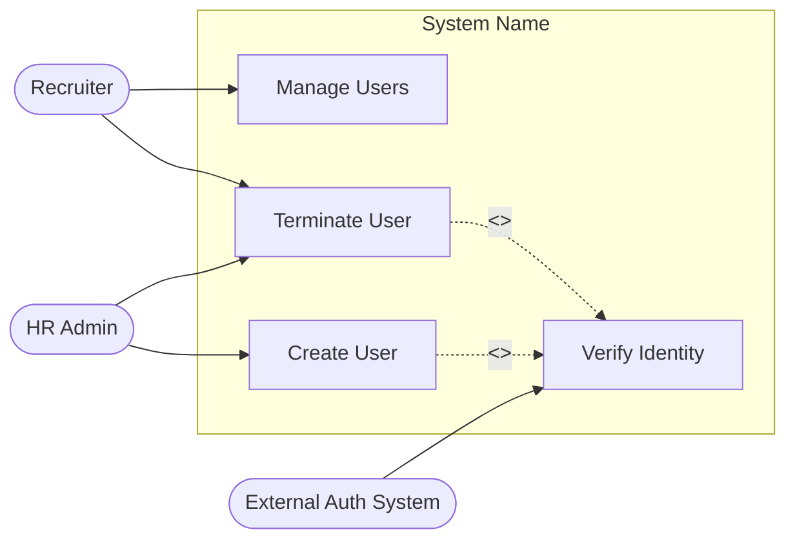
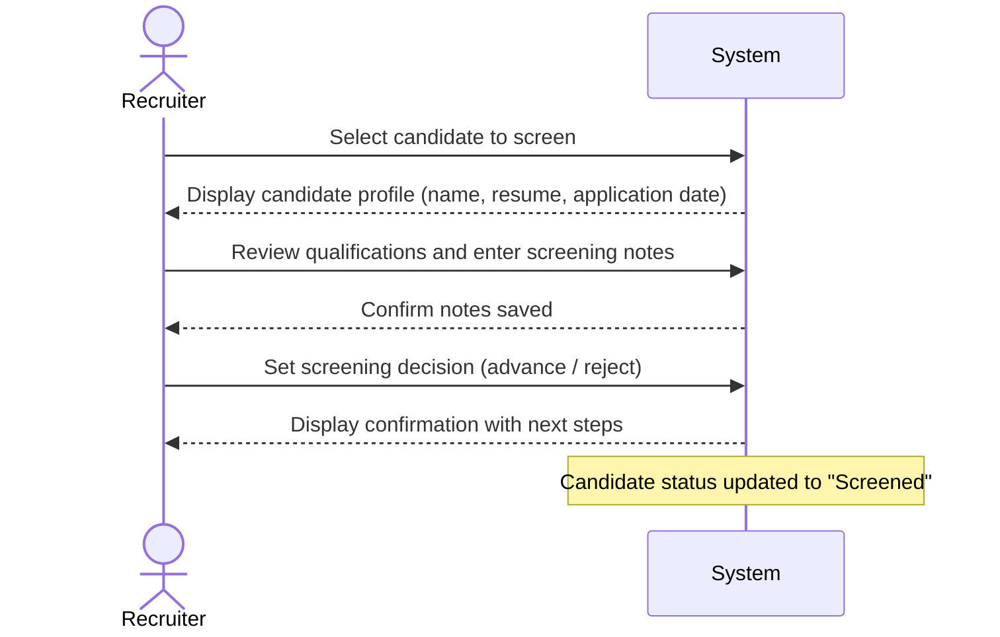
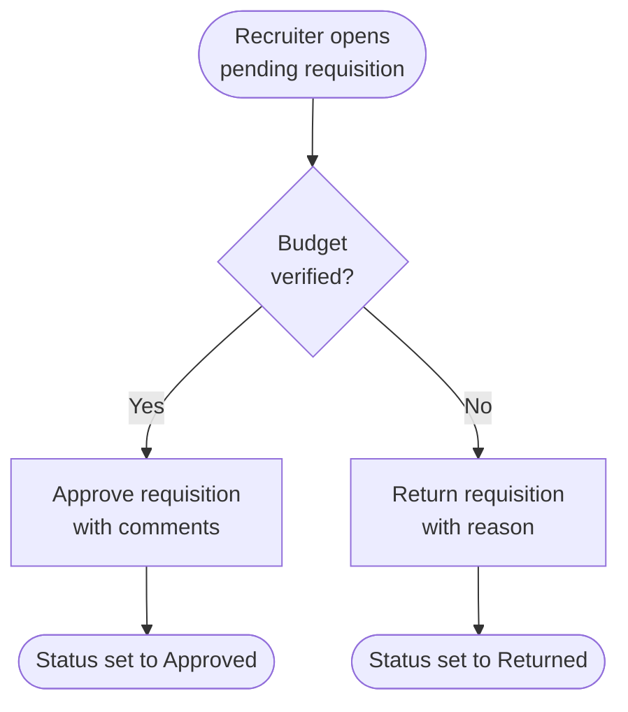
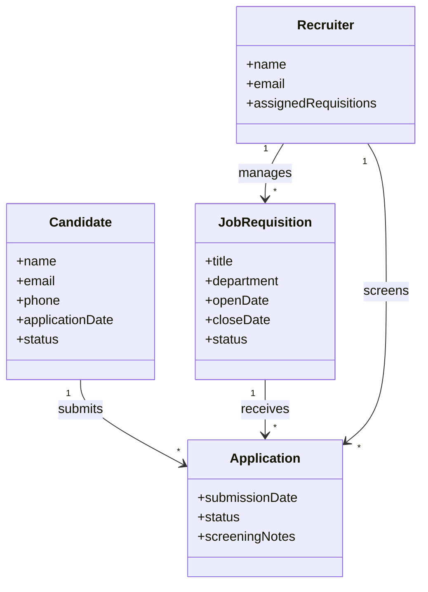
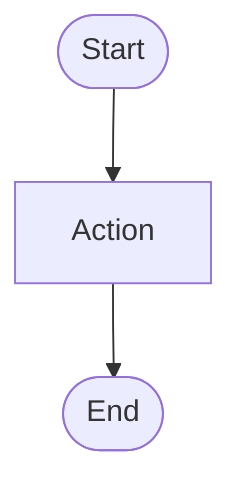
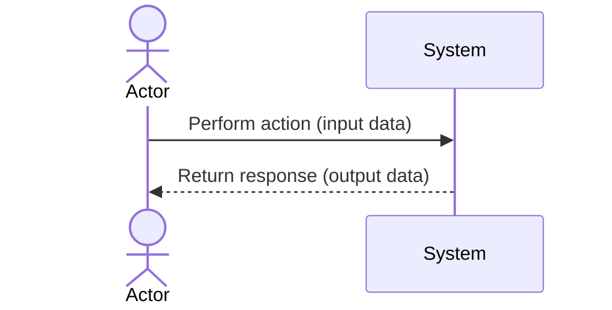

# Artifact Format Templates

## Project Charter / PRD Template

```markdown
# Project Charter: [Project Name]

## Vision
[One paragraph describing the desired end state]

## Problem Statement
[What problem exists today, who experiences it, and why it matters]

## Goals & Objectives
- [Goal 1]: [Measurable success criterion]
- [Goal 2]: [Measurable success criterion]

## Scope

### In Scope
- [Capability / feature area 1]
- [Capability / feature area 2]

### Out of Scope
- [Explicitly excluded item 1]
- [Explicitly excluded item 2]

## Constraints
- **Resources:** [Fixed team size, availability]
- **Schedule:** [Key dates, external deadlines]
- **Dependencies:** [External systems, vendor timelines, other teams]

## Key Epics
| Epic | Description |
|---|---|
| [Verb-phrase name] | [Brief description of the capability area] |

## Assumptions
| # | Assumption | Impact if Wrong | Status |
|---|---|---|---|
| A1 | [Assumption text] | [What changes] | Open / Resolved |

## Stakeholders
| Role | Name/Team | Involvement |
|---|---|---|
| [Role] | [Name] | [Approver / Contributor / Informed] |

## Success Criteria
- [Measurable outcome 1]
- [Measurable outcome 2]

## MVP Definition
[What is the minimum set of capabilities that makes this viable?]
```

---

## Feature Template (Cockburn-style)

```markdown
# Feature: [Verb-oriented Name]

**ID:** FT-[number]
**Primary Actor:** [Actor name]
**Goal:** [One sentence — what the actor is trying to accomplish]
**Scope:** [System or subsystem name]
**Level:** [User Goal / Summary / Subfunction]

## Preconditions
- [What must be true before this process can begin]
- [Another precondition]

## Postconditions (Success)
- [What is true in the system after successful completion]

## Postconditions (Failure)
- [What is true in the system if the process fails or is abandoned]

## Main Success Scenario
1. [Actor] [does something]
2. System [responds with something], displaying [specific data]
3. [Actor] [provides/selects/confirms something]
4. System [processes and responds]
5. ...

## Extensions
**3a. [Condition that triggers alternate flow]:**
  1. System [alternate response]
  2. [Actor] [alternate action]
  3. Return to step [N] / Feature ends

**4a. [Error condition]:**
  1. System [error response with specific message/behavior]
  2. [Actor] [recovery action]
  3. Return to step [N] / Feature ends

## Data Requirements
| Step | Data To System | Data From System |
|---|---|---|
| 1 | [What the actor provides] | — |
| 2 | — | [What the system displays] |
| 3 | [What the actor provides] | — |

## Special Requirements
- [Non-functional requirement specific to this feature, e.g., response time, accessibility]

## Related Features
- <<uses>> [FT-X: Shared Feature Name]
- <<extends>> [FT-Y: Optional Extension Name]

## Open Questions
- [Unresolved question discovered during elaboration]
```

### Feature Goal Levels (Cockburn)

- **Summary Level:** High-level business process spanning multiple user goals
  (e.g., "Manage Employee Lifecycle"). Usually maps to an Epic.
- **User Goal Level:** A complete, meaningful interaction an actor has with the system
  in one sitting (e.g., "Terminate Employee"). This is the sweet spot for features.
- **Subfunction Level:** A step within a larger goal that's reused across features
  (e.g., "Verify Identity"). These become <<uses>> relationships.

---

## User Story Template (Stage 5, `5-story-decomposition.md`)

```markdown
### [Story ID]: [Verb-oriented Title]

**Parent Feature:** FT-[number]: [Feature Name]
**Scenarios Covered:** [List all covered paths, e.g., Main Success, Extension 3a, Extension 4a]

> As a [specific actor role],
> I want to [specific goal — the deliverable user outcome],
> so I can [business value or benefit].

**Notes:**
- [Any context that helps understand the covered scenarios]
- [For a split: independent user value or phased delivery rationale, and any release dependencies]
```
*(Note: Each story's Mermaid Flow Chart and Summary Sequence Diagram are produced in Stage 8 inside the User Story Block (`8-user-story.md`).)*

### Story Naming Conventions

Stories derived from features follow a pattern. Alternate flows, recovery, and actor variations become
separate stories only when justified by the splitting criteria in [Stage 5](./stages.md#stage-5-story-decomposition);
otherwise, describe them in the original story's acceptance criteria.

| Source | Story Title Pattern | Example |
|---|---|---|
| Main Success Scenario | Same as feature name | "Terminate User" |
| Alternate flow | Describes the variation | "Terminate Disabled User" |
| Error recovery | Describes the recovery | "Recover from Error Terminating User" |
| Different actor path | Includes the actor distinction | "Terminate User as HR Admin" |

---

## Feature Diagram (Mermaid)

Use Mermaid flowchart syntax to represent feature diagrams (Cockburn/UML use case diagrams) since Mermaid doesn't have
a native use case diagram type.



Conventions:
- Actors use `(["Actor Name"])` (stadium shape)
- Features use `["Feature Name"]` (rectangle) inside a system boundary subgraph
- Solid arrows `-->` for actor-to-feature relationships
- Dashed arrows `-.->` with labels for <<uses>> and <<extends>>
- Keep each line inside a node label to **≤ 10–12 Chinese characters** (insert `<br/>` if longer) and wrap labels in double quotes so CJK text is never clipped by Mermaid's 200px label width cap

---

## Summary Sequence Diagram (Mermaid)



Conventions:
- Lines going toward the system (`->>`) are **events** (actor actions)
- Lines coming from the system (`-->>`) are **operations** (system responses)
- Include the data exchanged in parentheses after the action description
- Use `Note over` for important state changes or postconditions
- One diagram per significant scenario covered by a story

---

## Story Flow Chart (Mermaid)

Every user story gets its own flow chart, in addition to the Feature Diagram. It shows the
decision points and branches of the related scenarios the story covers.



Conventions:
- Use `flowchart TD` (top-down) so each story's flow reads from top to bottom
- Start and end points use stadium shapes `(["..."])`
- Actions use rectangles `["..."]`; decisions use diamonds `{"..."}`
- Label decision branches with `-- "是" -->` / `-- "否" -->` (or the relevant condition, ≤ 8–10 Chinese characters)
- **Prevent CJK text clipping (required):** Mermaid's `flowchart` renderer caps HTML label containers at `wrappingWidth: 200px` and does not auto-wrap Chinese text without spaces across display DPI scales, clipping single lines longer than ~12–14 Chinese characters on the right. Keep every line in a node (`["..."]`, `(["..."])`, `{"..."}`) to **≤ 10–12 Chinese characters** (≤ 8–10 in diamonds `{"..."}`). Whenever a label has multiple clauses (e.g., separated by `，` or `；`) or exceeds 12 Chinese characters, split it across lines using `<br/>` (for example, `Paused["倒數停止，顯示暫停狀態<br/>保留剩餘時間"]`). Always wrap labels in double quotes
- Cover the main success path and the extension/alternate branches the story addresses
- Keep the story title and flow aligned with its user outcome; multiple branches alone do not require a split

---

## Domain Model Diagram (Mermaid)



Conventions:
- Capture domain concepts from feature text (nouns = classes, verbs = relationships)
- Include key attributes (not exhaustive — this is analysis, not design)
- Show cardinalities
- Use relationship labels that describe the business relationship
- This is NOT a database schema or technical class diagram

---

## User Story Map (Stage 7, `7-user-story-map.md`)

Produce the map as a Markdown table grid, delivered as `7-user-story-map.md`. It follows the layered
layout: Epic → Feature → Details → Release slices. Do not use Mermaid for the
story map; Mermaid cannot render this grid as a table.

### Markdown Table Grid

The first column holds the layer/release slice label. Epics are the group headers, Features form the
first body row (backbone), and each following row is one detail position. A blank cell means nothing is placed there.

```markdown
| Epic | Epic 1：建立申請 | | Epic 2：審查候選人 | | Epic 3：安排面試 | |
|---|---|---|---|---|---|---|
| **Feature** | **提交申請** | **上傳履歷** | **篩選申請** | **排序候選人** | **預約面試** | **取消面試** |
| **Release 1（MVP）** | US-01 提交申請 | US-02 上傳履歷 | US-04 篩選申請 | US-05 排序候選人 | US-07 預約面試 | |
| | US-03 撤回申請 | | | | | US-08 取消面試 |
| **Release 2** | | US-06 補充履歷 | | US-09 標記候選人 | | |
| **Later** | | | | | | US-10 改期面試 |
```

Note: the table has one header row, so the Epic names sit in the header and the Features
sit in the first body row. Each Epic's Features are the consecutive columns under it. Release
slices are proposed here and confirmed in Stage 9.

**Column count (required):** every row, including the header and separator, must have exactly the
same number of cells. The number of columns equals 1 (label) + the total number of Features.
An Epic that spans n Features uses its name in the first of those n columns and leaves the other
n−1 cells blank (Markdown has no colspan). Before delivering, count the cells in each row and fix any
row that is short or long. A row with fewer cells renders as a broken table.

Conventions:
- **Epic** is the header group above its Features, in workflow order
- **Feature** is the second row (backbone), verb-oriented, in the order the user performs them
- **Details** are stories stacked under their Feature, core user outcomes first, then separately justified increments
- **Release slices** are the first column; the release label appears only on the first row of its block
- Card content is Story ID and title only

---

## User Story Block Template (Stage 8, `8-user-story.md`)

One block per user story. Keep the order: story, description, scenario coverage, business value, inline Mermaid flow chart, inline Mermaid summary sequence diagram, acceptance criteria, test cases.

````markdown
### [Story ID] [Verb-oriented story title]

- **故事 / Story**: As a [actor], I want to [goal], so that [benefit].
- **描述 / Description**: [Explain the usage context, what the user does, and the expected system response or outcome in plain language, using confirmed requirements.]
- **涵蓋情境 / Scenarios Covered**: [Parent Feature FT-XX; list all covered main, alternate, and error paths]
- **商業價值 / Business value**: [One or two sentences on the value this story delivers]
- **流程圖 / Flow chart**:

- **摘要序列圖 / Summary sequence diagram**:


**驗收標準 / Acceptance criteria**

- **AC-[NN]-1**: Given [precondition], When [action], Then [expected outcome].
- **AC-[NN]-2**: Given [precondition], When [action], Then [expected outcome].

**測試案例 / Test cases**

#### TC-[NN] [Descriptive name]

- **對應 / Covers**: [Story ID] / AC-[NN]-1
- **前置條件 / Preconditions**: [setup requirement]
- **測試資料 / Test data**: [specific input data]

| # | 操作 / Action | 預期結果 / Expected result |
|---|---|---|
| 1 | [What the tester does] | [What should happen] |
| 2 | [Next action] | [Expected response] |

- **後置條件 / Postconditions**: [what should be verifiably true after the test]
````

---

## Acceptance Criteria Format

Embed acceptance criteria directly inside each story's block in `8-user-story.md`. Always use Given/When/Then:

```markdown
**驗收標準 / Acceptance criteria**

- **AC-[NN]-1**: **Given** [precondition/context], **When** [actor performs action], **Then** [expected system behavior/outcome].
- **AC-[NN]-2**: **Given** [another precondition], **When** [another action], **Then** [another outcome].
```

---

## Summary Structure

The summary document (`9-summary.md`) serves as the executive overview and master navigation index for the entire
requirements set. Use the structure defined in Stage 9 of [stages.md](./stages.md). Rather than duplicating every
detailed scenario, flow chart, and test case from Stages 1–8, it provides a concise bird's-eye view of the project and
references the detailed stage documents as the single sources of truth.

Key principles for the summary:
- Include a table of contents with links to sections
- Summarize core scope, release slices, features, and stories concisely while cross-referencing `4-features.md`, `6-diagrams.md`, and `8-user-story.md`
- Include high-level overview diagrams inline (Feature Diagram and Domain Model Diagram, from `6-diagrams.md`) and reference `8-user-story.md` for per-story flow charts and summary sequence diagrams
- Consolidate key decisions, confirmed assumptions, known limitations, and open questions
- Include a glossary of domain terms
